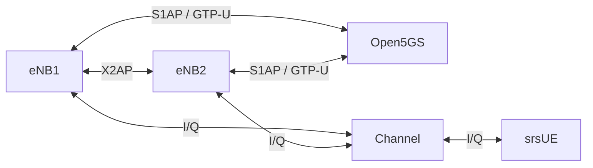

# srsRAN Mobility Lab

A containerlab setup for LTE handover testing with two srsRAN 4G eNBs, a software
UE, and Open5GS. A native X2 patch adds handover between the eNBs. The lab also
supports S1 handover.

Radio samples pass through a ZeroMQ channel that mixes both cells' I/Q streams.
Cell positions, transmit power, antenna patterns, and UE movement control the
coverage overlap and interference seen by the UE.



## Requirements

- Linux Docker with SCTP support and `/dev/net/tun`
- Python 3.10 or later, Git, and Internet access for builds
- About 4 CPU cores and 6 GB RAM for the default scenario

Tested on ARM64 Docker through Colima on macOS. The containerlab wrapper runs
against the current Docker context. It needs privileged access for containerlab;
the UE container uses `NET_ADMIN`, `SYS_ADMIN`, and an unconfined AppArmor profile
for its network namespace.

## Build

```sh
git clone https://github.com/ripclap/srsran-mobility.git
cd srsran-mobility

./scripts/bootstrap.sh
docker build -f Dockerfile.ran -t srsran-mobility-ran:verified .
docker build -f Dockerfile.core -t srsran-mobility-core:verified .
docker pull mongo:7.0
```

Bootstrap checks out the pinned srsRAN revision, applies
[the X2 patch](patches/srsran-x2.patch), and generates the lab configuration.
Docker builds use the same revision and patch. Subscriber credentials are
randomly generated under `build/`.

## Run

```sh
docker network create --internal --subnet 10.87.0.0/24 --gateway 10.87.0.1 srs-mobility-lab
LAB_HANDOVER_MODE=x2 ./scripts/containerlab.sh deploy --skip-labdir-acl -t mobility.clab.yml
```

The default scenario uses two cells 200 metres apart, one UE, 6 PRB FDD, and
EEA2/EIA2 security. The UE starts near eNB1. The network has no published ports.

Run the handover and X2 outage/recovery tests:

```sh
python3 scripts/verify.py --runtime containerlab --mode x2 --fault-test
```

Verification stops the radio and core containers to flush logs and captures.
Results are written to `build/results/verification.json`.

Clean up:

```sh
./scripts/containerlab.sh destroy -t mobility.clab.yml --cleanup
```

For S1 testing, deploy with `LAB_HANDOVER_MODE=s1` and verify with `--mode s1`,
without `--fault-test`. Start each test from a fresh deployment and the initial
UE position. Preserve `build/results/` and move aside `build/control.json` before
running `python3 scripts/generate.py` for another run.

### Docker Compose

```sh
LAB_HANDOVER_MODE=x2 docker compose -p srs-mobility up -d
python3 scripts/verify.py --runtime compose --mode x2 --fault-test
docker compose -p srs-mobility down
```

Use one launcher at a time; both use the same subnet.

## Coverage and movement

Edit [config/scenario.json](config/scenario.json), then run
`python3 scripts/generate.py` before deployment. The scenario defines cell
positions in metres, transmit power, antenna azimuth and beamwidth, path loss,
and channel impairments.

Move the UE during a running containerlab session:

```sh
docker exec clab-srs-mobility-channel python3 /lab/scripts/control.py --position 100 0
docker exec clab-srs-mobility-channel python3 /lab/scripts/control.py --position 190 0 --duration 20
```

Apply additional gain offsets to change the overlap:

```sh
docker exec clab-srs-mobility-channel python3 /lab/scripts/control.py --position 100 0 --offsets -15 0
```

Movement duration follows the radio clock. Channel state and per-cell received
power estimates are recorded in `build/results/channel-state.json` and
`channel.jsonl`. Power values are uncalibrated model inputs and estimates.

Optional per-cell channel settings:

```json
{
  "delay_samples": 1,
  "doppler_hz": 10,
  "fading": "block_rayleigh",
  "coherence_frames": 100
}
```

Noise is configured with `noise_std_iq` in the scenario's top-level channel
settings. Delay retains samples across frames, Doppler maintains phase
continuity, and fading uses a seeded random generator.

## Tests

```sh
docker run --rm -v "$PWD:/lab" --entrypoint python3   srsran-mobility-ran:verified -m unittest discover -s /lab/tests -v
```

See [testing](docs/testing.md) for recorded handover results and capture checks.

## Scope

This is an experimental srsRAN fork for a two-cell, one-UE FDD lab with a shared
MME/SGW and IPv4. X2 has been tested between peers running this fork. SGW
relocation and partial bearer admission are rejected.

The channel is a software I/Q model. Its timing depends on available CPU, and
it needs a coordinated restart if a radio source stops. Optional impairments
have unit-test coverage; the recorded handover runs used them disabled.

## Versions

| Component | Pinned version or revision |
| --- | --- |
| srsRAN 4G | `bef8680d5f9714f3e040e6f9cbc88d7888439b6d` |
| Open5GS | 2.8.0, commit `157f611a530e292e40ec50f9d23f0ef5d4fcd6a6` |
| ASN.1 compiler | `940dd5fa9f3917913fd487b13dfddfacd0ded06e` |
| X2AP schema | R14.6.0, OAI revision `29d5fa7d38bb1ee8935ef7ae30a396d53772ea4f` |
| Containerlab | 0.79.0 |
| Ubuntu | 22.04 |

Containerlab and Ubuntu image digests are pinned in the wrapper and Dockerfiles.
The schema download is checked against its SHA-256 hash.

## License

[AGPL-3.0-or-later](LICENSE). Dependencies retain their upstream licenses:
[srsRAN 4G](https://github.com/srsran/srsRAN_4G),
[Open5GS](https://github.com/open5gs/open5gs), and
[asn1c](https://github.com/mouse07410/asn1c).
